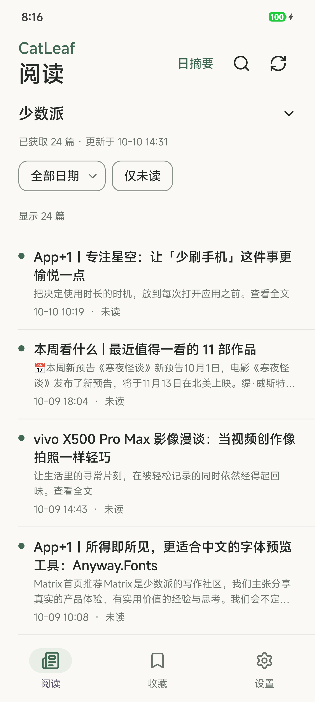
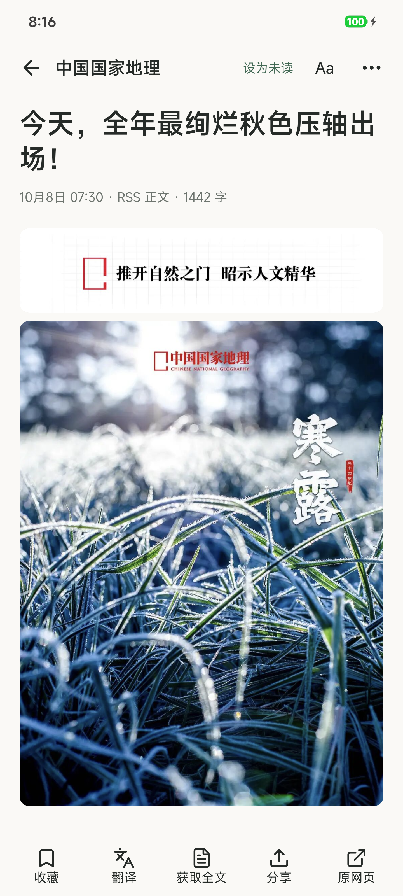
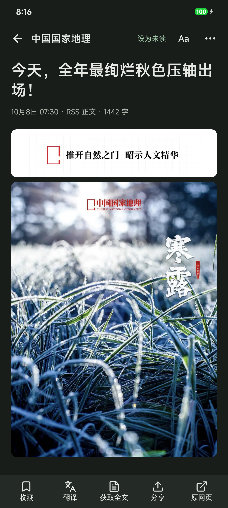
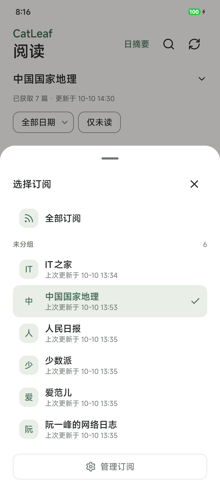
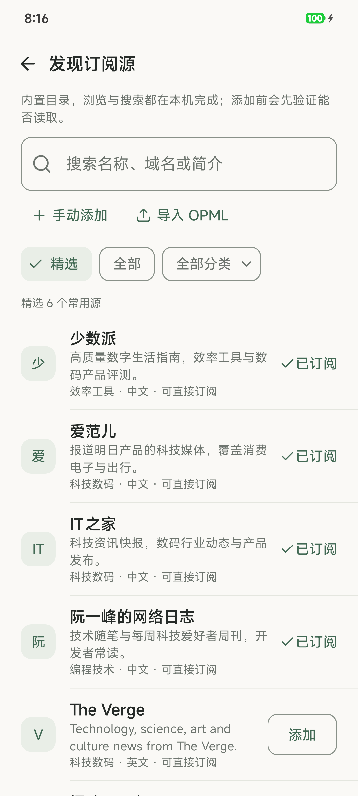
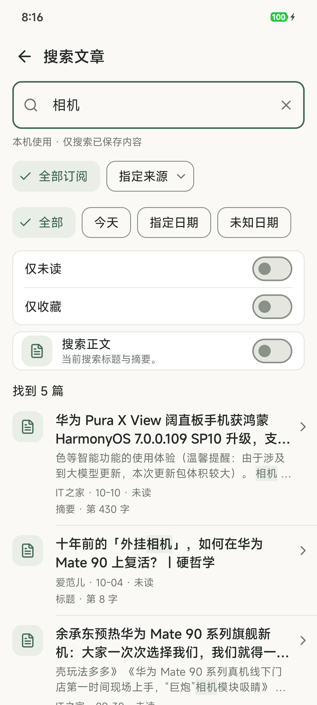

<div align="center">

<picture>
  <source media="(prefers-color-scheme: dark)" srcset="docs/assets/brand/catleaf-mark-dark.svg">
  
</picture>

<h1>CatLeaf · 猫页</h1>

<p>把喜欢的订阅，留给安静的阅读。</p>
<p>本机优先的 Android RSS 阅读器 · 暖白与森林绿 · 无需注册</p>

[](https://github.com/ShinonomeAya/CatLeaf/releases/tag/v0.1.22) [](LICENSE) [](https://github.com/ShinonomeAya/CatLeaf/actions/workflows/ci.yml)

**[下载 Android 测试版](https://github.com/ShinonomeAya/CatLeaf/releases/download/v0.1.22/catleaf-0.1.22-code23.apk)** · [发布说明](https://github.com/ShinonomeAya/CatLeaf/releases/tag/v0.1.22) · [使用指南](docs/14-本机使用与实例帮助.md) · [反馈问题](https://github.com/ShinonomeAya/CatLeaf/issues/new/choose)

</div>

猫页把订阅、阅读、搜索与收藏放在同一个地方。添加喜欢的 RSS／Atom 源，就可以在手机上阅读；全文获取、单篇图文离线和 AI 双语对照按需使用。普通阅读无需配置 AI，也无需部署服务器。

> 当前公开版本为 **0.1.22（code23）Pre-release 测试版**，最低 Android 10。完整兼容、性能与升级恢复验收仍在继续，详见[验收进度](#验收进度)。

## 界面预览

<table>
  <tr>
    <th align="center">阅读列表</th>
    <th align="center">图文阅读</th>
    <th align="center">深色主题</th>
  </tr>
  <tr>
    <td align="center"></td>
    <td align="center"></td>
    <td align="center"></td>
  </tr>
</table>

<details>
<summary>查看更多：订阅选择、发现订阅与文章搜索</summary>

<table>
  <tr>
    <th align="center">选择订阅</th>
    <th align="center">发现订阅</th>
    <th align="center">本地搜索</th>
  </tr>
  <tr>
    <td align="center"></td>
    <td align="center"></td>
    <td align="center"></td>
  </tr>
</table>

</details>

以上为 **2026-10-10、0.1.18/code19** 的真机截图，用于展示阅读体验，部分细节可能与当前版本不同。更多界面和素材说明见[真机截图目录](docs/assets/marketing/2026-10-10-phone/selected/README.md)。当前版本还支持同页标题与正文双语对照。

## 你可以用猫页做什么

| 能力 | 使用体验 |
| --- | --- |
| 订阅与发现 | 手动添加 RSS／Atom、浏览精选与分类目录、导入／导出 OPML，按自己的习惯分组 |
| 统一阅读 | 查看全部订阅或单个来源，按日期与未读筛选，继续加载已经获取的历史文章 |
| 全文与搜索 | 尝试从原网页补全正文，搜索本机已保存的标题、摘要与正文 |
| 收藏与离线 | 收藏想再看的文章，主动保存单篇正文与图片，断网时读取成功保存的内容 |
| 双语与日摘要 | 手动调用自己配置的 AI 服务，按段查看原文／译文，生成选定范围的日摘要 |
| 阅读偏好 | 切换浅色／深色主题与正文字号，保留阅读位置 |

本机模式是默认入口。需要服务端目录或抓取能力时，可以在设置中连接**自己的猫页实例**；本机与实例的数据分别保留。连接实例不代表已读、收藏或阅读位置跨设备同步。

## 下载与安装

| 项目 | 当前测试版 |
| --- | --- |
| 版本 | 0.1.22 · versionCode 23 · Pre-release |
| 系统 | Android 10 及以上 |
| 安装包 | 28.64 MB（28,641,758 bytes） |
| 包名 | `dev.local.catleaf.nativeapp` |

从[GitHub Release](https://github.com/ShinonomeAya/CatLeaf/releases/tag/v0.1.22)下载安装 APK，按 Android 的提示完成安装。已有猫页请使用同包名、同签名且版本号更高的 APK **覆盖升级**，保留原数据。

Release 附有 SHA-256 校验文件；包大小、完整哈希和签名证书摘要见[版本清单](docs/releases/0.1.22/release.json)。App 在线检查更新服务尚未接通，请通过本仓库 Releases 获取版本。

## 开始阅读

1. 从首次引导或**发现订阅源**选择感兴趣的来源，也可以手动添加地址或导入 OPML。
2. 在阅读页选择**全部订阅**或单个来源，按日期与未读状态筛选。
3. 打开文章阅读；只有摘要时，可尝试**获取全文**。想离线阅读时，主动保存正文与图片。
4. 需要翻译或日摘要时，再到设置中配置自己的 AI 服务，并手动确认生成请求。

### 历史文章与本机搜索

RSS 通常只提供近期条目，首次添加不等于抓取网站全部历史。每次成功获取的文章记录会累积保存在本机，超过首批 200 篇可以继续加载。搜索只查当前使用方式下已保存的内容，不搜索互联网。

### 正文、图片与离线保存

全文提取和图片加载受原站格式、网络与访问限制影响。普通缓存可能被清理；收藏与主动离线包分别保护，离线仅保证成功保存的正文和图片。

单图上限 **10 MiB**，单篇离线预算 **20 MiB／50 图**，总预算 **300 MiB**。预算不足会提示部分完成，不能把“已收藏”或“保存了链接”当作已经完整离线。

### 需要配置或登录的订阅

部分目录条目需要你先配置自己的 RSS 生成服务，再添加可读取的 HTTPS 订阅地址。猫页当前不接收原站的账号 Cookie／Token；仍要求登录的内容可能无法直接读取。配置要求以发现页说明和原服务文档为准。

### 数据、隐私与 AI

订阅、缓存、阅读与收藏状态默认保存在设备上。猫页没有应用内账号、广告或分析 SDK；网络请求发往订阅／文章来源、你配置的实例，以及你主动使用的 AI 服务。

实例与 AI 密钥通过 Android Keystore 保护的密钥加密，存放在应用私有文件。AI 请求会将确认范围内的文章文字发送给你选择的供应商，可能产生费用；不配置 AI 也可以阅读。

OPML 和阅读状态导出不包含正文、离线图片、AI 结果或密钥，不能代替完整数据备份。订阅 URL 可能自带访问参数，导出文件请私密保存。详细说明见[本机与实例帮助](docs/14-本机使用与实例帮助.md)及[数据与权限说明](docs/公开APK首发材料.md#数据与网络说明)。

## 验收进度

0.1.22 最终源码的 **194 个单元测试通过**，Debug／Release 构建成功；lint 为 **0 错误、27 警告、2 提示**。Android 16 测试手机完成同签名保数据升级、主题与筛选面板、全部订阅 200→400→600 继续加载、国家地理图文、旧离线包断网强停重开等定向复测。

完整 Android 10／页面矩阵、大规模性能与图片内存、完整 TalkBack／键盘、凭据升级与恢复故障等仍待验证。**G7 尚未通过，G8/L09 未正式交付。** 当前公开测试版与完整验收分别记录，见[最终候选验收摘要](docs/2026-10-11-最终候选验收与公开准备.md)和[当前任务](tasks/todo.md)。

## 开发与构建

| 部分 | 技术栈 |
| --- | --- |
| Android 客户端 | Kotlin、Jetpack Compose、Room、DataStore、OkHttp、受控 WebView |
| 正文处理 | jsoup 统一净化、Readability4J 全文提取 |
| 可选实例后端 | TypeScript、Cloudflare Pages Functions、D1／KV、Drizzle ORM；保留 Neon 回退 |

### 构建 Android 客户端

准备 **JDK 23** 和 **Android SDK 36**，将 `JAVA_HOME` 与 `ANDROID_HOME` 指向本机安装目录。可在 Android Studio 中打开 `android-native/`；Windows PowerShell 也可以运行：

```powershell
git clone https://github.com/ShinonomeAya/CatLeaf.git
cd CatLeaf/android-native
.\gradlew.bat :app:testDebugUnitTest :app:lintDebug :app:assembleDebug
```

调试 APK 输出到 `android-native/app/build/outputs/apk/debug/`。依赖版本锁定在[版本目录](android-native/gradle/libs.versions.toml)，开发与验证约定见[AGENTS.md](AGENTS.md)。仪器测试仅在隔离模拟器执行。

Release 使用自己的签名材料与本地 `keystore.properties` 配置，再运行 `:app:assembleRelease`。没有签名配置时产物为未签名 APK；自己的签名不能覆盖安装官方签名包。私钥、口令及本机配置不得提交。

<details>
<summary>开发可选实例后端（本机阅读无需运行）</summary>

在仓库根目录使用 Node.js 22 或更高版本：

```powershell
npm ci
npm run test:core
npm run lint
npm run typecheck
npm run build
npm run dev
```

`npm run dev` 启动 Wrangler 本地 Pages Functions 服务，默认端口 8788。`npm run build` 编译后端到 `dist/_worker.js/`；`npm run preview:cf` 运行构建产物。根目录 npm 命令提供后端 API，App 界面由 `android-native/` 构建，宣传官网独立开发。

API 需要配置自己的实例凭据，详见[接口契约](docs/04-架构与接口契约.md)。`wrangler.toml` 中的 D1／KV 资源 ID 为占位符；使用自己的资源配置。本机配置可另存于已忽略的 `wrangler.local.toml`，通过 `--config wrangler.local.toml` 使用。本地密钥放在已忽略的 `.dev.vars`，字段参考[配置示例](.env.example)；AI Key 只在 App 配置，不传给后端。

部署工作流仅手动触发。自行部署前设置仓库变量 `CLOUDFLARE_PAGES_PROJECT` 和 GitHub Secrets：`CLOUDFLARE_API_TOKEN`、`CLOUDFLARE_ACCOUNT_ID`、`D1_DATABASE_ID`、`KV_NAMESPACE_ID`。本地构建不会部署或上传。

</details>

### 项目资料

[产品需求](docs/03-PRD.md) · [接口契约](docs/04-架构与接口契约.md) · [页面说明](docs/05-页面与状态说明.md) · [设计规范](docs/07-设计规范.md) · [原型](docs/prototypes/README.md) · [验收摘要](docs/validation/验收记录.md)

## 反馈与参与

维护者：[ShinonomeAya](https://github.com/ShinonomeAya)。欢迎提交问题、建议或 Pull Request；开发前请阅读项目约定，并保留已有数据和安全边界。

- **功能问题与建议**：[GitHub Issues](https://github.com/ShinonomeAya/CatLeaf/issues/new/choose)。请附版本、设备、重现步骤及脱敏截图。
- **安全问题**：[私人漏洞报告](https://github.com/ShinonomeAya/CatLeaf/security/advisories/new)，详情见[SECURITY.md](SECURITY.md)。不要把 Key、Cookie、私人订阅或数据库放进公开 Issue。

## 项目来源／开源许可

后端基于 [Sallyn0225/gemini-rss-app](https://github.com/Sallyn0225/gemini-rss-app) 的提交 `36d0fa44aabc8f17c7d2e73ec382124677551262` 继续开发；当前客户端采用 Kotlin／Jetpack Compose。项目保留原 **MIT** 许可及 `Copyright (c) 2025 su-kaka`，见[LICENSE](LICENSE)。

第三方依赖与图标许可见[随包许可声明](android-native/app/src/main/assets/licenses/THIRD-PARTY.txt)及[素材说明](docs/assets/README.md)。截图中的文章与图片归原内容提供者所有，保留来源标识；公开仓库采用审查后的新历史，原始设备证据和本机配置保存在仓库外。
