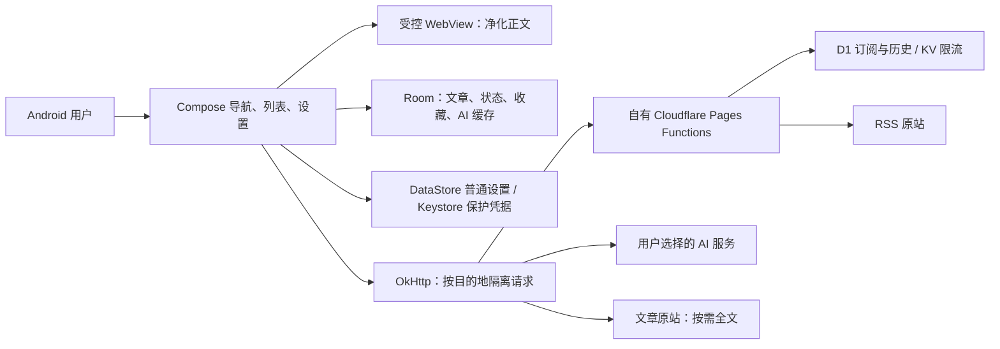

# CatLeaf Android 落地方案 v2.0

日期：2026-09-22。按用户体验优先的要求，复评后采用 **Kotlin + Jetpack Compose + 原有自有轻量后端**；替代此前 React + Capacitor 最终客户端方案。修改依据见 [开源复评](./09-原生路线复评与开源对比.md) 与 [ADR 002](./decisions/002-Android原生客户端.md)。这次交付的是更新后的规划，不是原生代码或新 APK。

## 1. 系统分工

手机负责交互、离线、已读/收藏、手动 AI 和缓存。后端负责订阅、RSS/历史及全文兜底。AI Key 不交给 RSS 后端；实例密钥不发给 AI 或原站。首版不新增账号体系、同步服务器、常驻抓取服务或 AI 网关。

## 2. 技术选型与边界

| 层 | 当前方案 | 原因与验收 |
| --- | --- | --- |
| Android 主界面 | Kotlin + Jetpack Compose，单 app 模块 | Android 专用，直接处理返回/生命周期/无障碍；不是换默认 Material 皮肤，沿用猫页规范 |
| 状态 | ViewModel、StateFlow、Kotlin 协程；最少明确的数据访问层 | UI 从状态渲染，IO 不阻塞主线程；不预建多层 Clean Architecture 和注入框架 |
| 本地结构化数据 | Room / SQLite | 事务、SQL 校验和迁移；收藏、离线、杀进程和升级须真机验证 |
| 普通设置 | DataStore | 主题、字号和非敏感配置；不存明文凭据 |
| 凭据 | Android Keystore 的不可导出加密密钥 + 应用私有目录中的凭据密文 | API Key 是被加密的数据，不是直接当 Keystore 密钥导入；无明文落盘，不承诺对已攻陷设备绝对安全 |
| 网络 | OkHttp；按实例、AI、原站限制目标与请求头 | 带凭据请求拒绝重定向，公开抓取逐跳检查；不依赖浏览器 CORS 或公共代理 |
| 正文 | Android WebView + jsoup 净化 + App 自有排版样式 | 不开启 JS/原生 JS 桥；只展示正文，外链隔离；保留表格/图片/代码块兼容性 |
| 全文提取 | RSS 优先，按需原生 HTTP + JVM 兼容 Readability 实现，自有提取兜底 | N01/T12 核对解析器兼容/许可，不在 Kotlin 内强行运行原 npm 解析器；失败保留 RSS |
| 后端 | 原 Cloudflare Pages Functions + D1 + KV，TypeScript | 复用 handlers/repository，T03/T06/T07 完成私有化和边界加固 |
| 资源 | 已定稿 SVG → VectorDrawable/Compose 矢量；平台资源按现有猫标 | 不增加第二套图标风格；旧 android/ 已转换的平台资源可核对复用 |

版本不从竞品机械复制；N01 选稳定、互相兼容且满足 minSdk=29 的 Kotlin/Compose/AGP/Gradle/JDK/Room 组合，记录来源并锁定。不为了“最新”引入预览版，也不把当前机器的 JDK23 当作新工程的固定要求。[Compose](https://developer.android.com/develop/ui/compose/documentation)、[Room](https://developer.android.com/training/data-storage/room)、[Keystore](https://developer.android.com/privacy-and-security/keystore)、[jsoup 清洗](https://jsoup.org/cookbook/cleaning-html/safelist-sanitizer)

## 3. 复用、重做与保持

| 对象 | 处理 |
| --- | --- |
| 已引入源码/许可证、Cloudflare handler/repository/schema | 保留；在既有基础上加固，不同时替换后端 |
| API、文章身份、日期、备份与 AI 协议 | 保持契约；Kotlin 重新实现客户端，固定样例验证跨语言一致性 |
| React UI、浏览器存储、Capacitor 插件 | 保留为历史与行为参考；不作为新客户端依赖，不承诺维护第二套完整产品 |
| 旧 android/、APK、截图 | 保留；不覆盖不卸载，新客户端拟建 android-native/ |
| 猫页品牌、22 张原型、52 个 SVG | 沿用；原生图标转换及字号/触摸区另验收 |
| 用户可能已有的旧包数据 | 先盘点，保留旧包；不默认可直接迁入 Room，也不以卸载重装冒充升级 |

## 4. 首版仍然做什么

连接自有实例、订阅增删改、OPML、当前源阅读、全文兜底、已读/收藏、已保存文本离线、手动中文翻译、可追溯单源日摘要、缓存管理、状态备份恢复。详细边界、上限和错误处理沿用 [PRD](./03-PRD.md)。AI 不可用时仍可阅读。

不新增跨源时间线/摘要、自动付费 AI、后台抓取通知、多设备同步、iOS、上架、图片离线。刷新仍为前台按需与下拉，不承诺 App 关闭期间完整收集 RSS。需要服务端定时聚合时再比较 FreshRSS/Miniflux，不因为客户端变原生就同时换后端。

## 5. 实施与质量关卡

先保留已完成 T01/T02 的证据，新增 N01/G0-N 原生最小包；之后 T04/T05 验证 Room、凭据、实例连接与请求隔离。基本阅读/离线闭环通过 G4 后再推进 AI；完整 A/B 验收、Release 性能、用户真机、正式签名升级都必须重新验证。具体依赖以 [计划](../tasks/plan.md) 和 [任务卡](../tasks/todo.md) 为准。

已有旧包约 9 秒首屏空白需要记录，但不是框架横评结论。新包性能目标仍为 200 篇缓存下 20 次 Release 采样，冷启动 P95≤2.5 秒、本地详情≤1 秒；没有实测前不宣称达标。

旧 15–25 日估算失效；N01/G1 后按实际实现速度和待解决问题重估。费用不作为主要限制也不意味着扩张产品范围。Cloudflare/AI 的实际费用、地区可达性按用户账号、模型和网络验收；不保证永久免费。

## 6. 交接

开发 AI 使用 [新版提示词](../tasks/原生路线开发交接.md)。先检查差异和最近验收记录，保护正在进行的后端工作。只改当前任务所需文件；不自动推送、部署、分发，也不反复询问已确定路线。包名、签名、账号和设备按实际阶段落实。
