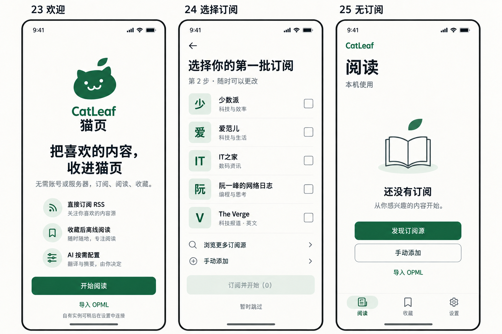
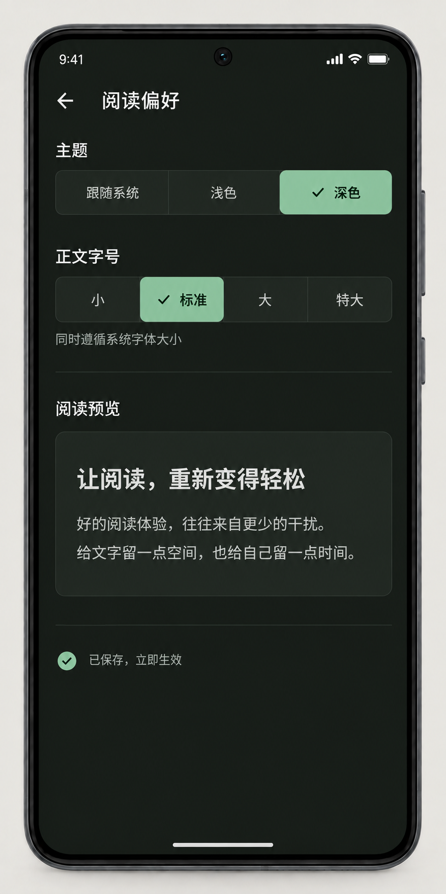

# CatLeaf 原型 01–40 真机对照与还原计划

日期：2026-09-28。状态：**审查与返修计划；本轮未修改业务代码，不是 G7/G8 通过报告。**

## 1. 结论与证据边界

**原型已经放进项目，问题是实现没有完整落实设计。** 01–22 是 22 张当前独立 PNG，23–34 是 4 张三屏板，35–40 是 2 张三屏板：共 28 张当前图片、40 个页面编号。01/11 的旧版本另外保留，不能把旧版混入当前统计。文件入口：

- [01–22 索引](prototypes/README.md)
- [23–34 增量索引](prototypes/incremental-local/README.md)
- [35–40 增量索引](prototypes/incremental-search-offline/README.md)
- [52 个生产 SVG 的索引](assets/README.md)、[设计规范](07-设计规范.md)

本轮逐张查看了这 28 张当前原型；在连接的手机上实际导航、截图，并检查相关 Compose 实现。用户指出的欢迎页缺品牌/功能图标、阅读空态缺插画/按钮层级、阅读偏好缺分段控件/预览卡片，均有依据。新增发现包括发现源、使用方式、搜索、离线管理等页面的结构差异。

**不是 40 个运行状态都已在手机重现。** 全新引导、导入/恢复结果、复制结果、AI 结果、验证失败和图片部分失败等不能由当前页面无条件进入。本报告把真机、用户截图、源码检查、未观察状态分开，所有 40 个编号均有记录；未观察状态继续待验，不以旧截图补成“本轮通过”。

### 当前实测基线

| 项目 | 本轮事实 |
| --- | --- |
| 手机 | Xiaomi 2304FPN6DC，ADB serial `测试设备A` |
| 显示 | 1440×3200，density 560，约 411dp，font_scale 1.0；本轮深色现场 |
| 应用 | `dev.local.catleaf.nativeapp`，已安装 `0.1.2 / code 3`；没有重新构建或安装 |
| 源码 | HEAD `781620798ece762ea19f30021fe72ed1cee31612` + 大量既有未提交/未跟踪工作；不将 HEAD 当成完整候选源码 |
| 范围 | user0 当前本机空态；另查看手机既有 XSpace 隔离用户空间 的多源/文章状态；二者证据不混算为同一数据集 |
| 操作边界 | 未提交订阅表单、未导入/恢复/复制、未改密钥、未触发 AI、未保存/删除离线包；未清库、卸载、升级、提交、推送或部署 |
| 自然状态变化 | 导航阅读时 App 自动刷新列表；打开 隔离用户空间 一篇文章触发正常已读/读位记录及图片加载。不是“零状态变化”测试 |
| 收尾 | 已回到 user0 本机阅读页；未改主题、系统字号、密度、网络配置 |

[设备基线](validation/2026-09-28-prototype-audit/baseline.txt) · [本轮截图清单](validation/2026-09-28-prototype-audit/README.md)。本轮不重算历史测试数量、APK 哈希或性能结论。

### 不能误判的部分

- 真机文章截图中有图片，大标题可随正文滚出：不能继续沿用早期“所有正文无图/标题固定”的结论。见原型 02 行。
- 五源精选名称和顺序已经存在；发现页问题主要是结构/入口/信息表达，不是五源数据全丢了。
- 搜索结果已有命中高亮；当前缺的是范围说明、结果数量位置、正文搜索独立区域等，不能说搜索没有实现。
- 38 保存确认已有文章预览、选项和取消；无正文时禁止保存正确。要补的是布局细节和明确的获取全文去路。
- 标准支持长列表标题必要时三行、无缩略图时不占位；不能只因某篇文章长或 RSS 无封面就判错。

## 2. 与开发进度合并后的判断

| 阶段 | 当前口径 | 本轮新增影响 |
| --- | --- | --- |
| L00–L07 | 计划标记完成，主要功能/定向验证已有 | **视觉完成不能成立**。L04 引导/发现、L05 使用方式、L06 筛选等重新挂视觉返修，不回滚已验证底层逻辑 |
| L03 目录 | 当前矩阵记录 303 条、12 类（78 可收录、225 需配置）；另有 35 条待复验 | 保留可用性边界，不把“入目录”写成全部可直接订阅；本轮只观察精选/分类 UI，没有重测 303 个 URL |
| Q01–Q03 | 代码与定向证据已有，整项未验收 | 35–40 增加视觉整改；2,000 篇正文搜索有效 UI P95 仍缺 |
| Q04 | 真机局部恢复/幂等/图文离线证据已有 | 跨范围、磁盘/写入故障、完整状态升级仍待；本轮无新增写入验收 |
| L08 / G7 | 未通过 | 35 项矩阵仍为 2 项整项通过、4 项局部、29 项待验。A03/A05 的已有整项记录主要为隔离 AVD 证据，不能称本轮手机全部通过 |
| L09 / G8 | 隔离验证已开始，正式交付未完成 | code2→code3 隔离用户空间、本地 D1 恢复/回滚为局部证据；旧实例完整状态、远端 D1/KV、独立部署端到端未完成 |

依据：[当前验收矩阵](validation/2026-09-27-当前验收矩阵.md)、[G8 隔离总结](validation/2026-09-28-g8-isolated-upgrade/SUMMARY.md)、[验收记录](validation/验收记录.md)末尾。历史“L01–L09 未开始”、旧 Q04 缺口等须按带日期的新记录理解；本报告不把任务条数换算完成百分比。

仍保留全部原门槛：2,000 篇正文 UI 搜索 P95、10,000 混合身份、启动器图标计时、Android 10 完整组合、外接键盘、TalkBack 实际播报、Q04 故障/升级、收费 AI 真实结果及完整 01–40 证据。视觉修复不替代这些任务。

## 3. 原型 01–40 逐页映射

证据类型：**真机**＝本轮当前包已看到该页面/注明的局部状态；**用户图**＝用户上传，包版本未核；**源码**＝实现检查，不等于真机；**待触发**＝目标状态本轮未见。一个页面的空态截图不代表其正常/失败态通过。

三屏板的“左/中/右”明确指所在列。修复组 UIR 的详细做法见下一节。

| 编号 / 当前原型 | 本轮运行证据 | 差异、还原目标与结论 |
| --- | --- | --- |
| 01 [阅读列表](prototypes/01-reading-home-v2.png) | 真机：[列表](validation/2026-09-28-prototype-audit/27-u999-home.png) | 根标题/文章结构已有；筛选仍旧版，按 32 修复。缩略图只在真实可用时显示，不硬塞原型照片。UIR05/19；待视觉验收 |
| 02 [文章阅读](prototypes/02-article-reader-v1.png) | 真机：[页首](validation/2026-09-28-prototype-audit/48-reader.png)、[滚动](validation/2026-09-28-prototype-audit/51-reader-scrolled.png) | 大标题同滚、图片显示通过本次观察；“更多”仍文本而非 ellipsis 图标，紧凑栏操作偏密。译文/真实全文/失败图状态未覆盖。UIR16 |
| 03 [订阅管理](prototypes/03-subscription-manager-v1.png) | 真机：[32 源管理](validation/2026-09-28-prototype-audit/30-u999-manager.png)、[空管理](validation/2026-09-28-prototype-audit/16-manager-empty.png) | 分组缺折叠指示；行尾同时编辑/删除，ellipsis 实际直接编辑，与菜单意图不符；发现入口弱。UIR11 |
| 04 [摘要结果](prototypes/04-daily-digest-v1.png) | 待触发；本轮未生成 AI 内容 | 不判已还原。补概览/要点/来源编号/生成信息/不完整结果及引用跳转；UIR18 的隔离结果验收 |
| 05 [旧首次连接](prototypes/05-instance-setup-v1.png) | 历史入口已由 23/30 替代 | **禁止恢复强制连接后端**。品牌改用正式 A 猫；连接表单作为设置可选路径，按 30，不照旧 05 抢占欢迎入口 |
| 06 [收藏列表](prototypes/06-favorites-v1.png) | 真机：[仅空态](validation/2026-09-28-prototype-audit/44-favorites.png) | 空态仅大段文字；正常收藏卡、已存文本/仅书签/删源保留三态本轮未见。UIR03/18，不能据空态判列表通过 |
| 07 [设置](prototypes/07-settings-v1.png) | 真机：[设置](validation/2026-09-28-prototype-audit/02-settings.png) | 已有前导图标和平面行，但分组层次/行说明过长；本机状态仍容易被“当前实例”标签误导。结合 29 重组，保留新增入口。UIR15 |
| 08 [选择订阅面板](prototypes/08-source-selector-v1.png) | 真机：[初始](validation/2026-09-28-prototype-audit/28-u999-selector.png)、[展开](validation/2026-09-28-prototype-audit/29-u999-selector-expanded.png) | 初始多源面板管理入口在下方；源的数量/状态说明缺失。选中和长名继续保护，管理入口固定可达。UIR11 |
| 09 [添加订阅](prototypes/09-add-subscription-v1.png) | 真机：[空表单](validation/2026-09-28-prototype-audit/17-add.png) | 字段空时标签落框内，缺原型独立标签/占位层级；按钮胶囊形。添加中另见33，不混同。UIR12/19 |
| 10 [OPML 预览](prototypes/10-opml-preview-v1.png) | 待触发；未选文件 | 逐组、统计、勾选、重复/无效原因、目标范围、底部确认都须截图；无新视觉通过结论。UIR18 |
| 11 [OPML 结果 v2](prototypes/11-opml-result-v2.png) | 待触发；未写入 | 按 v2 的成功/失败/待确认三态及后续动作核查，不能用旧 v1。UIR18 |
| 12 [AI 设置](prototypes/12-ai-settings-v1.png) | 真机：[未配置](validation/2026-09-28-prototype-audit/08-ai.png) | 输入层级/按钮形状需统一；“尚未测试”不宜用加载图形冒充忙碌。未填写密钥/未测试网络，已配置与错误态待验。UIR12/19 |
| 13 [摘要范围](prototypes/13-digest-scope-v1.png) | 真机：[未选日期](validation/2026-09-28-prototype-audit/53-digest-scope.png) | 日期可点击但外观像静态大标题，缺日期选择指示；默认缺日期用大段错误色，未配置提示图标语义不准。选日期后的候选/计数还需补图。UIR17 |
| 14 [存储备份](prototypes/14-storage-backup-v1.png) | 真机：[存储](validation/2026-09-28-prototype-audit/10-storage.png) | 统计未成组，普通缓存数量缺“篇”；导出/恢复/离线入口仍大面积实底块，需平面图标行。保留新增离线保护说明。UIR15 |
| 15 [恢复预览](prototypes/15-restore-preview-v1.png) | 待触发 | 按当前 v2/范围说明更新旧图信息，不省来源→目标和不含正文/密钥提示。UIR18 |
| 16 [阅读偏好](prototypes/16-reading-preferences-dark-v1.png) | 真机：[偏好](validation/2026-09-28-prototype-audit/03-preferences.png)；用户图亦一致 | 分散 chip 替代分段控件，默认宽度字号出现 3+1；缺勾选符号、系统字号说明、预览卡、保存反馈。UIR04 |
| 17 [实例管理](prototypes/17-instance-management-v1.png) | 真机：[本机模式打开的管理式表单](validation/2026-09-28-prototype-audit/05-connect.png) | 页面有保存 origin，但本轮未证明实例活动/已连接；须区分“已保存配置”和“当前活动方式”，管理与30首次连接标题/操作不同。UIR10 |
| 18 [关于](prototypes/18-about-v1.png) | 真机：[关于](validation/2026-09-28-prototype-audit/14-about.png) | A 猫与版本存在，不能判 Logo 未接入；缺品牌短句/底部上游说明层次，五行辅助文案都是“查看”。保留五个法律/帮助入口。UIR15 |
| 19 [恢复结果](prototypes/19-restore-result-v1.png) | 待触发 | 成功、跳过、失败、重试统计和原数据保留提示需真实结果截图，UIR18 |
| 20 [旧阅读空态](prototypes/20-reading-empty-v1.png) | 真机：[当前空态](validation/2026-09-28-prototype-audit/01-initial.png) | 已被25更新；保留书页插画设计语言，采用发现/手动/OPML三个去路，不保留旧强制实例逻辑。UIR03 |
| 21 [离线阅读](prototypes/21-reading-offline-v1.png) | 待触发；本轮不改手机网络 | 离线横幅、缓存/无缓存、失败图片、禁用网络动作须另验；在线正常图不能证明离线。UIR18 |
| 22 [编辑订阅](prototypes/22-edit-subscription-v1.png) | 真机：[编辑](validation/2026-09-28-prototype-audit/31-u999-edit.png) | 只读URL已有；缺只读原因/状态层级，删除在列表显露而非页面底部危险区；共用表单仍需还原。UIR11/12 |
| 23 [欢迎：左](prototypes/incremental-local/23-25-onboarding-v1.png) | [用户图](validation/2026-09-28-prototype-audit/user-23-welcome.jpg)+源码 | 缺正式Logo、CatLeaf猫页组合、三个图标功能行和直接OPML入口；本轮没重置引导来截图。UIR01 |
| 24 [五源引导：中](prototypes/incremental-local/23-25-onboarding-v1.png) | 源码；真机待触发 | 实现是左复选框+文字，无中性字标/右复选框、发现更多/手动添加导航。保留五源默认未选和顺序。UIR02 |
| 25 [本机空态：右](prototypes/incremental-local/23-25-onboarding-v1.png) | 真机：[空态](validation/2026-09-28-prototype-audit/01-initial.png) | 缺插画和双按钮；无源仍显示筛选与0篇统计；“后续的发现页”过时。UIR03 |
| 26 [发现：左](prototypes/incremental-local/26-28-discovery-v1.png) | 真机：[精选](validation/2026-09-28-prototype-audit/19-discovery.png) | 无中性图标、行内添加/已订阅动作、手动添加/OPML快捷入口；全部分类藏在长横条最后。UIR06 |
| 27 [分类面板：中](prototypes/incremental-local/26-28-discovery-v1.png) | 真机：[半展开](validation/2026-09-28-prototype-audit/25-categories.png)、[展开](validation/2026-09-28-prototype-audit/26-categories-expanded.png) | 12项文本长列表替代2列分类，缺关闭按钮/选中对勾/可用性筛选。展开后12项可见，不能说分类丢失。UIR07 |
| 28 [源详情：右](prototypes/incremental-local/26-28-discovery-v1.png) | 真机：[详情](validation/2026-09-28-prototype-audit/20-source-detail.png) | 小底部面板替代整屏；原始URL/核查/内部来源词堆叠；缺身份头、复制/查看网站、分组/明确订阅动作。UIR08 |
| 29 [使用方式：左](prototypes/incremental-local/29-31-instance-copy-v1.png) | 真机：[本机方式](validation/2026-09-28-prototype-audit/04-usage.png) | 只有当前方式卡和连接按钮，缺本机/实例双层卡、三项好处、能力边界、帮助链接。UIR09 |
| 30 [连接实例：中](prototypes/incremental-local/29-31-instance-copy-v1.png) | 真机：04→[05-connect](validation/2026-09-28-prototype-audit/05-connect.png) | 从连接入口却出现“当前实例/换密钥”的管理语境；应按进入意图分标题/状态/提交文案，保留预填origin且密钥不回显。UIR10 |
| 31 [复制预览：右](prototypes/incremental-local/29-31-instance-copy-v1.png) | 源码；本轮活动实例状态未进入 | 当前 UsageScreen 把选择/复制内联在使用方式页；需独立预览步骤、源→本机、真实计数、取消。不得另造复制业务引擎。UIR09/18 |
| 32 [筛选：左](prototypes/incremental-local/32-34-filter-add-v1.png) | 真机：[列表筛选](validation/2026-09-28-prototype-audit/27-u999-home.png) | 仍“全部已获取、今天、日期未知、仅未读、指定日期”；与已批准四日期+独立未读不同。UIR05 |
| 33 [添加中：中](prototypes/incremental-local/32-34-filter-add-v1.png) | 源码；忙碌真机待触发 | 已有 Box 中央文字+固定左spinner，不能重报旧挤移必现；要测默认/大字加载前后文字中心、禁用对比度。UIR12/18 |
| 34 [已添加但验证失败：右](prototypes/incremental-local/32-34-filter-add-v1.png) | 待触发 | 不重复新增，区分保存与验证；完整失败图标/源卡/重试/管理/继续阅读待验。UIR18 |
| 35 [标题摘要搜索：左](prototypes/incremental-search-offline/35-37-search-v1.png) | 真机：[空输入](validation/2026-09-28-prototype-audit/34-u999-search.png)、[结果](validation/2026-09-28-prototype-audit/39-u999-search-results.png) | 输入框替代标题栏，无范围说明，缺首屏结果数；日期旧顺序。已有片段高亮保留。UIR13 |
| 36 [正文搜索：中](prototypes/incremental-search-offline/35-37-search-v1.png) | 真机：[开关已选](validation/2026-09-28-prototype-audit/40-u999-body-search.png) | 用普通chip混排未读/收藏/正文，缺独立开关区与“仅已保存”说明；本次结果命中摘要，**未证明长正文命中或性能**。UIR13 |
| 37 [无结果：右](prototypes/incremental-search-offline/35-37-search-v1.png) | 源码；非空查询0结果本轮未稳定触发 | 代码空态只有Text；需图标、条件说明和清筛选/改词行动，不把空输入态算此页。UIR13/18 |
| 38 [离线确认：左](prototypes/incremental-search-offline/38-40-offline-v1.png) | 真机：[无正文分支](validation/2026-09-28-prototype-audit/50-offline-confirm.png) | 已有预览与选项；长标题摘要撑大卡片、整卡强调色、必需正文呈checkbox不清；缺直接“返回获取全文”行动。正常可保存分支待验。UIR14 |
| 39 [图片未齐：中](prototypes/incremental-search-offline/38-40-offline-v1.png) | 待触发 | 需正文✓/图片x/y/仅失败重试/读正文/管理的真实部分失败状态，不拿历史离线可读替代。UIR14/18 |
| 40 [离线管理：右](prototypes/incremental-search-offline/38-40-offline-v1.png) | 真机：[空列表](validation/2026-09-28-prototype-audit/11-offline-empty.png)+源码非空分支 | 有总预算及当前范围数字，但未明确范围名，缺容量卡/条目状态图标/右侧菜单；本轮非空列表未触发。UIR14 |

## 4. 用户三个问题：直接对照

### 4.1 欢迎与无源空态（23/25）

原型左列是欢迎、右列是无源阅读，中央是下一步五源引导：

| 23 用户提供的欢迎页（非本轮重置所得） | 25 本轮真机阅读空态 |
| --- | --- |
|  |  |

### 4.2 阅读偏好（16）

| 16 原型 | 本轮真机 |
| --- | --- |
|  |  |

此处不是换一下字号就完成：分组、分段选择、选中对勾、预览容器和保存反馈都需要落实。保留系统字号放大；不能靠缩小全局文字或关闭 fontScale 来复刻图。

## 5. 还原要求与代码落点

以下是 20 个整改/验证工作组，**不等于 20 个全部真机复现的功能故障**。P1＝阻碍本轮核心视觉交付，P2＝一致性/信息层级；“待触发”组必须先复现再决定修改。源码路径均在 `android-native/app/src/main/java/dev/local/catleaf/nativeapp/`。

### UIR01 · 欢迎品牌与真实导航（P1，23）

- 证据：用户图 + `ui/onboarding/OnboardingScreen.kt:137`，欢迎分支只有 Text/Button/TextButton，没有 Icon/Image。
- 使用正式 `docs/assets/brand/catleaf-mark.svg` 的现有原生猫标资源，居中品牌区显示 CatLeaf / 猫页；增加订阅阅读、收藏离线、实例可选三个图标功能行，复用现有 SVG。图标20–24dp，48dp触摸只用于可点击项；品牌按比例保留留白，不截取原型 PNG。
- 恢复“开始阅读”主操作和“导入 OPML”次操作；开始进入24，导入接现有预览，取消返回欢迎。跳过仍可用，不能只把“可以稍后导入”当实际入口。
- 验证：全新隔离 profile、跳过、导入取消、完成后冷启不重走；360dp/1.3 能滚动至操作，旧实例用户升级不重新引导。

### UIR02 · 五源选择结构（P1，24；源码已确认，真机待验）

- 落点：同一 OnboardingScreen 的第二步，当前左 checkbox + 文本。
- 按原型做中性字标 + 名称/一句说明 + 右侧选择框。固定少数派、爱范儿、IT之家、阮一峰的网络日志、The Verge；默认0项，禁止默认全选。
- 增加“发现更多订阅源”“手动添加”实际导航，确认按钮用真实选择数；保留批次部分成功、跳过与返回语义。只扩展路由回调，复用现有添加/发现/OPML，不复制业务流程。
- 验证：0/1/5项、长源名、失败重试不重复、返回保留选择、正文加载不被选择页阻塞。

### UIR03 · 阅读/收藏空态（P1，20/25，06补态）

- 落点：`ui/reading/ReadingScreen.kt` 无订阅分支；收藏空态在 `ui/favorites/FavoritesScreen.kt`。
- **已有插画**：`docs/assets/illustrations/empty-reading-light.svg` / `empty-reading-dark.svg`，无需重新设计。当前原生 drawable 未包含该插画；按需转换并检查多路径、透明区域和颜色，显示宽160–200dp、保持240:200比例。
- 无订阅时保留根标题/底部导航，中部是插画→短标题→一行说明→实底“发现订阅源”→描边“手动添加”→文字“导入 OPML”。隐藏无意义的日期筛选、已获取0篇和底部0篇未读统计；删除“后续的发现页”表述。
- 有订阅无文章、筛选无结果、离线无缓存与无订阅分开：不能都导向发现。收藏空态复用已有空态语言并提供“去阅读”，正常收藏仍按06单独验。
- 验证：三个去路可达且取消回原处；空态主体在可用内容区居中，360dp/大字体可滚动，不硬算物理屏幕中心。

### UIR04 · 阅读偏好（P1，16）

- 落点：`ui/settings/SettingsScreen.kt` 的 ReadingPreferences / SettingChip。
- 恢复“主题”“正文字号”“阅读预览”三级区块。主题3段、字号4段；字号标签显示小/标准/大/特大即可，16/18/20/22放辅助说明，不把数字挤进每个按钮。
- 默认411/412dp与font1.0用等宽分段，选中同时有勾和底色。窄屏/大字实在不容纳时用明确的2×2字号选项，不采用默认3+1散落，也不缩小字或触控区。
- 预览采用独立表面、12dp圆角、16–24dp内边距，标题+两段样文，正文跟随用户字号和18/30行距比例。补“同时遵循系统字体大小”及真实保存成功反馈；不能刚点击就无条件写“已保存”。
- 验证：设置与Reader Aa共用，四档预览、主题/字号重启持久化；读位/已有译文不受布局改动破坏。

### UIR05 · 阅读/搜索筛选（P1，01/32/35/36）

- 落点：`ui/reading/ReadingScreen.kt:252`附近、`ui/search/SearchScreen.kt`日期区，当前两处都残留旧文案/顺序。
- 日期单选固定 **全部 → 今天 → 指定日期 → 未知日期**；“仅未读”独立开关，搜索可另有“仅收藏”。清除筛选清两维，指定日期显示实际日期。不同维度不能排成同一组互斥标签。
- 24dp边距；横滑只处理日期不足宽度，当前选择有对勾/状态语义；不能为了全塞一行缩字号。全文库/已加载统计文案仍按PRD，不把“全部”解释为抓取了全历史。
- 验证：日期×未读组合、无结果清除、切范围恢复；阅读和搜索相同日期边界语义。保留现有规则函数，只改必要组件/文案。

### UIR06 · 发现源列表（P1，26）

- 落点：`ui/discovery/DiscoveryScreen.kt`。
- 结构：标题/短说明→带搜索图标输入框→手动添加与OPML→精选/全部/固定分类入口→源列表。全部分类必须首屏可达，不能排在12个横滑分类之后（本轮需多次横滑才找到）。
- 每行：中性字标、名称、一句纯文本说明、分类/语言/可用状态、右侧添加或已订阅；字标用系统文字加底色，不伪造官方Logo。行内添加复用现有验证流程，需配置源显示解释，不能盲发请求。
- 已有搜索/五源数据保留；语言ZH/EN换可理解展示，内部来源词如preferred-five不作为正文标签。
- 验证：精选/全部、搜索组合、已订阅、需配置、待复验、长名、列表复位；303条状态不能被一个绿色“可用”覆盖。

### UIR07 · 分类面板（P1，27）

- 落点：同上分类sheet。真实现状是单列文本；半展开只见一部分，展开可见全部12项。
- 顶部标题+关闭，二列等宽分类单元，当前分类有勾/语义；下方按当前PRD提供可用性筛选，帮助区解释需配置。短屏允许内容滚动，固定头/关闭可达，避免最后几项与手势区重叠。
- 验证：12项逐个选择后列表类别一致；返回/取消保留条件；大字体不能截断分类名或只靠颜色识别。

### UIR08 · 目录源详情（P1，28）

- 落点：`DiscoveryScreen.kt` 的详情sheet及导航入口。
- 改为原型整屏结构：返回/源身份→描述与分类语言→可用性说明→RSS URL/网站与复制→分组/订阅动作。先展示用户理解的信息，核查时间与来源解释放次层，保留真实地址可查。
- 已订阅禁重复，需配置源先解释，URL复制和查看网站用既有平台能力。已有添加表单/校验可复用，不引入第二套订阅存储。分组若仍通过预填表单编辑，页面明确“继续添加”，不要写内部实现“添加（预填表单）”。
- 验证：整屏返回保留发现搜索/滚位；无凭据公开源与实例请求隔离不变；长URL换行不撑破按钮。

### UIR09 · 使用方式与复制（P1，29/31）

- 落点：`ui/settings/UsageScreen.kt:182`。本机分支只有当前卡+连接按钮；实例分支把复制源列表直接放同页。
- 29恢复本机/可选实例清晰层次、收益图标行、限制提示和本地帮助入口。文案直接依据[本机与实例帮助](14-本机使用与实例帮助.md)：服务端订阅目录、已保存文章快照、部分抓取协助；**不承诺收藏/已读跨设备同步、完整备份、持续归档**。
- 31通过“复制已下载数据”进入独立预览步骤，展示来源→本机、真实源/文章/状态计数、勾选与空间风险、确认/取消。沿用已有 ViewModel 与事务；不自动复制、切换或拉远端历史，不复制密钥/离线图片包。
- 验证：取消0写入、复制结果后主动切本机、原实例保留、范围切换旧预览失效。此轮没进入活动实例，31必须补截图再签。

### UIR10 · 连接和管理语义（P1，17/30）

- 落点：`ui/instance/InstanceSetupScreen.kt`、入口的管理模式参数。
- 本机→连接入口用30“连接自有实例”，说明成功后切换；活动实例管理用17“实例管理/更换密钥”。保存过origin不等于当前正在使用它，状态卡必须由实际scope/连接状态决定。
- 输入固定可见标签、掩码密钥、接收方提示、帮助、主提交/取消；保留origin预填和密钥不回显。错误紧贴字段，不偷换成重新强制首配。
- 验证：未连接/保存但非活动/活动/离线/401/TLS/503；取消返回29不改scope，成功才切换。真实提交留给隔离配置，禁止为截图写用户线上实例。

### UIR11 · 管理列表与选源（P2，03/08/22）

- 落点：`ui/feeds/FeedManagerScreen.kt`、`ui/reading/ReadingScreen.kt`选源sheet。
- 管理恢复分组标题+数量+折叠指示，行名/域名或更新状态/失败指示，单一overflow打开管理动作；若图标是ellipsis就必须打开菜单，不直接编辑。删除放菜单/编辑页危险区并确认，不每行常驻垃圾桶。
- 选源面板保持选中行内边距与对勾，补源状态/数量（只有真实数据）；列表可滚动，管理入口固定在面板底部，不能随32源列表埋掉。当前源若不在首屏，首次展开定位到当前项或明确显示当前选择。
- 验证：多组长名、失败源、当前项在第32项、收起/展开、编辑返回原滚位；删除只是可见性整改，不实际删用户源做验收。

### UIR12 · 表单、加载与AI设置（P2；33忙碌证据待补）

- 落点：`FeedManagerScreen.kt`共享表单、`ui/settings/AiSettingsScreen.kt`、InstanceSetupScreen。
- 标签固定在输入上方，框内是示例占位；字段16/24，辅助13/20；必填/可选统一，12dp按钮圆角。编辑URL锁定原因和最近验证状态按真实字段显示，不能硬写“连接正常”。
- 加载按钮代码已有中央Box+左spinner：保留它，用同宽按钮前后截图验证文字中心不偏，360dp/1.3也不碰撞；不以“有代码”代替33截图通过。
- AI未测试用中性状态图标，真实请求中才旋转；接收方、费用/未配置可读说明保持准确。密钥不读出、不进证据。
- 验证：空输入、焦点、错误、禁用、慢请求、键盘、长URL；选正确真实文件，不另建重复表单系统。

### UIR13 · 搜索结构与空态（P1，35–37）

- 落点：`ui/search/SearchScreen.kt`。当前数目只可能出现在底部“加载更多”，不是原型首屏结果统计；默认/正文说明共用旧文案。
- 加独立“搜索文章”标题，带搜索/清空输入，注明当前本机或实例范围和仅本地已保存内容；来源/日期/未读/收藏清晰分组。正文开关放独立行/卡，有文件图标和“包括已保存原文，不联网补全文”的说明。
- 首屏显示真实结果总数，列表保留高亮，把标题→命中片段→来源/日期/命中位置和保存状态按层级排。徽标只有真实状态才显示，不能从示例补假“已下载”。
- 空输入与非空0结果分开。37用搜索图标、当前条件说明、清筛选/修改关键词；不能只Text。保留防抖、分页、范围失效、LIKE转义，不因UI返修改数据库/重建全文索引。
- 验证：标题/摘要/正文各命中、零结果、中文长词、清空、键盘、返回列表锚点。当前40截图命中摘要，不计正文性能；2,000篇UI P95仍按原标准测。

### UIR14 · 保存确认、结果与离线管理（P1，38–40）

- 落点：`ui/reader/ReaderScreen.kt`离线分支、`ui/settings/StorageScreen.kt:422`起。
- 38已有正确基本结构，修长标题/摘要的预览层级：文章标题17/24、最多合理行数配正文预览；普通表面用正文色，不能整卡都像选中主操作。必需正文显示已选且不可取消，只有图片可切换。
- 无正文分支提供明确“返回获取全文”入口；当前只有禁用保存和一句提示。在线返回原文章的获取全文流程，离线解释不可获取，不后台自动发起。保留仅供App内阅读、上限与独立于收藏的说明。
- 39按实际保存结果显示正文✓、图片x/y、失败说明、重试失败项/阅读/管理；未齐不写全成功。此状态本轮未见，先做隔离失败样本。
- 40顶端容量卡明确“所有使用方式”总预算及“当前本机/实例”占用，当前字样不能只写“当前范围”；统一MiB/实际预算口径。非空按原型图标+标题+状态/大小+右菜单，移除/重试不能每行堆成大卡按钮；空态说明操作去路。
- 验证：全部/仅文本/部分/中断/保存中/空/超限；只读回放可用于视觉，但实际保存、取消、断网、强停与写盘故障仍需原Q03/Q04验收。

### UIR15 · 设置、存储、关于（P2，07/14/18）

- 落点：`SettingsScreen.kt`、`StorageScreen.kt`。
- 设置按阅读与内容/连接与服务/本机数据/关于组织，加入29后避免“实例”标题统辖所有本机功能。说明控制行长，详细边界进下一页，保留现有Lucide前导图标。
- 存储统计成组、数字加单位（普通缓存968应为968篇），入口用图标/正文/次说明/chevron；不把导出、恢复、离线三个入口全做强调大卡。保留OPML在管理的既有去路，不为照旧图重复新增业务。
- 关于保留正确A猫、真实版本和五个入口；加品牌短句及上游MIT归属说明层次，各项辅助文案写内容而非五个“查看”。图18旧叶标不复活，授权/隐私全文不能删。
- 验证：大字、滚动到底、帮助返回、只读版本与实际包一致；不测导出就声称备份通过。

### UIR16 · 阅读器细节（P2，02）

- 现有标题同滚、正文图、底部五动作都保留；按28/36标题、18/30正文核对，不因图中标题短就压缩长标题。
- 紧凑顶栏“更多”替换已交付ellipsis图标，Aa/设为未读布局保持48dp触摸，不让来源名被压到不可识别。其他动作需保留可访问名称。
- 首屏“摘要/无正文”与内容长度分层，不因为摘要里包含图片就谎称已取全文。此次图片加载正常；图片失败/离线替代文案、译文排版另补状态。
- 验证：长中英文标题、滚动、Aa、更多、摘要/正文/译文三态；不回归早先读位、净化器与WebView安全。

### UIR17 · 摘要范围（P2，13）

- 落点：`ui/digest/DigestScreen.kt:159`的 ScopePage。
- “选择日期”可点击但缺外观提示：加日历/下拉与清晰48dp选择区域。未选择的初始引导采用辅助说明；提交后无效才错误色，不让默认页像发生故障。
- 有日期后按原型排列来源/时区、候选数、勾选数和总字符；未配置AI卡使用设置/信息语义，底部保持费用提示+禁用原因。未生成不展示假的摘要统计。
- 验证：取消日期、有效日期0篇/有文章/超上限、未配AI；范围预览不自动调用服务。

### UIR18 · 未触发页面与特殊状态（P1验收工作；未确认差异不先改）

| 页/状态 | 最少复现条件 | 要留下的证据 |
| --- | --- | --- |
| 23/24全新流程 | 隔离全新profile或既有隔离AVD，不清当前用户资料 | 欢迎、0/多选、更多/手动/OPML取消、完成冷启 |
| 06正常收藏 | 隔离数据：已存正文、仅书签、源已删各1项 | 三种状态同列表、进入详情/返回；不拿空收藏图代替 |
| 04结果、02译文 | 先用现有隔离测试缓存驱动真实UI；真实服务另需App内配置和费用授权 | 正常/失败/部分结果、引用和来源、真实与合成标明 |
| 10/11、15/19 | 隔离OPML/v2文件含成功/重复/无效/失败 | 预览、取消、实际结果、重试；写入必须隔离 |
| 17/30/31活动实例 | 无私人凭据的隔离自有测试实例或既有假实例测试 | 连接/失败/取消、源→本机预览、复制统计与结果 |
| 21离线 | 隔离设备有缓存/无缓存样本，可控断网 | 横幅、网络按钮、占位图与本地文本；恢复网络 |
| 33/34 | 隔离可控延迟/失败RSS，登记成功但验证失败 | 提交前/中/后文字中心，失败完整屏，重复操作不重复新增 |
| 37 | 非空无匹配词与有效筛选，无网络调用 | 条件保留、无结果插图/动作、清筛选和改词返回结果 |
| 38正常、39、40非空 | 隔离包：图齐/部分/中断/文字/无正文各状态 | 确认/取消、部分结果、列表和菜单，不只函数单测 |

没有直接可用数据的状态先补隔离数据再截图。可复用现有探针/测试，不在正式App增加调试入口、不硬编码示例文章、不把测试页面当生产页面。若缺设备/授权明确留待验，不为凑40页清空用户数据。

### UIR19 · 共用尺寸、图标、按钮（P1，跨页）

- 颜色和typography已接入，不整体推倒。`ui/theme/Theme.kt`未统一shapes且各Button仍用M3默认外观；已观察主按钮多为胶囊，与规范12dp不符。只在实际使用的按钮/容器统一必要参数，别全局误改switch/thumb/导航选中形状。
- 412dp标准左右24dp，360dp可20dp；App bar56dp、根导航72dp+系统安全区；图标20–24dp且触控≥48dp。表单16/24、辅助13/20；不能用更小文字规避排版。
- SVG来源继续是[素材索引](assets/README.md)，复用已有转换器 `tools/svg2vd.mjs` 和原生资源；品牌/复杂空态转换后必须肉眼核对镂空、描边、透明度。没有必要引入新的图片/图标/设计系统依赖。
- 每页只一个主强调动作；普通信息卡不整块高饱和、整段绿色；深浅色逐项映射，不照原型渐变、手机框、时间、内容数字生产。
- 窄屏/大字优先换行、滚动、次动作菜单，不缩字、不关闭系统字体缩放。安全区仅处理一次。

### UIR20 · 设计完成与验收口径（P1，台账）

- 把L04/L05/L06/Q01–Q03的“功能完成”与“视觉待整改”并列；不抹除历史通过记录，也不继续仅凭功能路径勾“原型还原”。
- 每条返修必须有原型编号/版本、当前包真机图、修后同状态图、差异说明、剩余状态，不能只附Gradle通过。
- 图片对照按内容结构/设计token与行为，不对生成图做机械像素相似度。系统栏、机身比例、示例内容差异不算缺陷；缺入口、插画、信息层级和错误组件属于缺陷。
- 原型05→23/30、20→25、01筛选→32，以及新增35–40，以增量优先。正式A猫优先于旧图叶标；功能/安全按PRD、视觉尺寸按规范。

## 6. 增量返修实施顺序

此为本次审查提出的实施批次；本轮只写计划，未开始修改App。

| 批次 | 依赖 | 范围 | 完成条件 |
| --- | --- | --- | --- |
| VR0 证据/素材核对 | 本报告 | UIR19/20：保护dirty基线，建立40行前后证据表，确认正式SVG/native映射；只补真正缺资源 | 确定截图APK/源码差异，素材可绘制；无旧证据冒充新包 |
| VR1 用户明确三项+筛选 | VR0 | UIR01–05：23/24/25、16、32及阅读/搜索同类筛选 | 411dp/默认字号整体布局先对齐；360dp/1.3无溢出；欢迎各去路、无源三操作、保存反馈真实 |
| VR2 发现与可选实例 | VR1 | UIR06–10：26–31 | 分类首屏可达、12类面板、源详情整屏、实例收益/帮助、连接语义/复制独立预览；取消不写入 |
| VR3 旧页面一致性 | VR1 | UIR11/12/15/16/17：03/07–09/12–14/17/18/22/02 | 平面行/字段/按钮/顶栏统一；多源面板管理固定；保留所有已测功能 |
| VR4 搜索与单篇离线 | VR1；必要时VR3共用样式 | UIR13/14：35–40 | 范围与结果数清楚，正文开关独立，37无结果可恢复；38无正文有去路，39/40状态与菜单准确 |
| VR5 结果态补全 | VR2–4 | UIR18：04/06/10/11/15/19/21/31/33/34/37/39等 | 每个缺状态用隔离数据走真实UI，缺项仍明确待验；真实AI另记授权/费用 |
| VR6 独立视觉回归 | VR1–5 | 40编号按实际适用版本核验，深浅×360/412×1.0/1.3；键盘/读屏关键链 | 所有P1闭环；截图不遮信息，确认图标/层级/间距/行为；不能只交一张首页 |
| VR7 回原G7/G8收口 | VR6与既有功能/性能任务 | 原A/B/C矩阵、性能、故障、升级/恢复/部署边界 | 按原标准逐项签核；隔离G8已开始不等于正式G8完成 |

VR1之后先做一次用户可见的真机对照交付，避免又完成一轮功能后才发现风格偏差。已有网络/数据库/净化/范围隔离算法尽量不动；必要导航修改需带取消/返回回归。

### 每批交付最低格式

1. 列出本批UIR编号、对应原型编号、动过的文件与尚未触发状态。
2. 保存**同主题、同字号、同宽度、同数据状态**的修前/修后图；页内长内容额外拍底部/键盘态，不能把未滚到的按钮判缺失。
3. 颜色、文字token、边距/尺寸按源码与布局界限核对；确认图像没有文字遮挡，图标不变形。默认四档字号分段和大字降级布局分别截图。
4. 运行受影响的JVM/仪器及构建/lint；设备仪器只用隔离模拟器，手机做同签名Release验收。纯视觉无需写大量镜像实现的快照单测，路由/状态/保存反馈改动要有有意义回归。
5. 写APK版本/哈希/签名和源码dirty基线。若这次没产新包就写未产，不挪用别批哈希。
6. 更新逐页表：实现完成 / 本地回归 / 真机视觉 / 特殊状态 / 整项通过分开。G7/G8不因视觉修完自动勾选。

## 7. 当前可以交给开发的范围

无需再选技术栈或重画全部原型，按现有40编号与规范增量还原即可。第一批应执行VR0→VR1；之后按依赖进入VR2–VR7。对本报告标为源码/待触发的页面，先补现场证据再改，避免为不存在的问题重写功能。

用户目前无需重新提供Logo或PNG。后续真正依赖用户/环境的只有：可用于写入与故障的隔离设备/数据、真实AI调用授权、必要的自有隔离实例，以及人工TalkBack播报/实体键盘验证；密钥在App内填写，不进聊天、日志或截图。

**本轮完成的是原型资产核实、真机视觉抽取、40编号审查表及返修计划。尚未完成的是全部40运行状态的真机截图与还原验收；App修复、G7整项、正式G8交付均未完成。**
