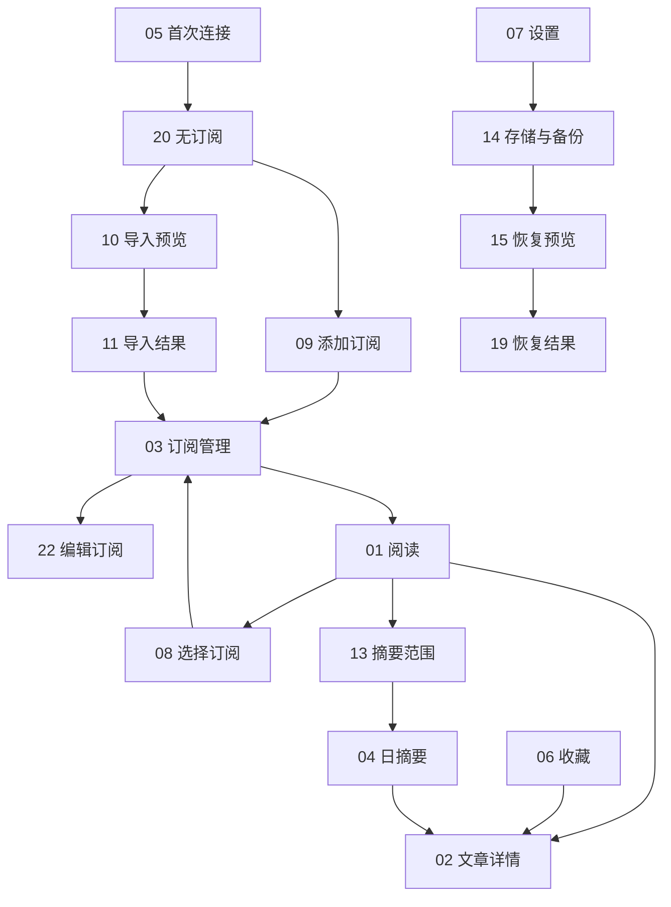

# CatLeaf（猫页）Android 完整页面原型

**2026-09-30已确认局部修订**：原型01/06/07的根页头部统一「CatLeaf→页面标题」，旧07的相反顺序被[设计规范§11](../07-设计规范.md)局部覆盖；品牌20/28、标题30/38、动作与两行块居中。06收藏空态复用现有empty-reading浅/深SVG，02正文/封面结构与21/38–40单图10MiB边界按[返修计划](../../tasks/全文图片与界面返修计划.md)。不增加页面编号或冒称PNG已重生成；其他原型保持。

**同日v3.1增量：[文章搜索与单篇离线35–40](incremental-search-offline/README.md)，新增2张三屏评审板、6个页面状态。当前原22张独立图＋6张增量评审板（23–40共18状态），不是40张独立PNG。**

**2026-09-25当前增量：[本机模式、引导与分类发现23–34](incremental-local/README.md)。新增4张评审板、12个页面状态，保留下面22张历史独立图；不是34张独立PNG。首次强制连接、设置使用方式、发现入口、日期筛选与添加状态以增量图及PRD v3为准。新旧图都是静态设计，运行验收仍待L08。**

日期：2026-09-22。**当前版本共 22 张独立 PNG**，覆盖 P01–P07 全部核心模块、主要子流程，以及首次空态、离线缓存、深色偏好和部分失败示例。01、11 使用 v2；02–04 沿用首批认可图片；其余为同风格扩展。历史 01-v1、11-v1 另行保留，不计入 22 张。

用户已确认品牌和首批视觉方向；新增页面是该方向的延伸设计，尚未逐页获得用户评审。图片为静态评审稿，不是可点击原型、真机截图或已实现界面。颜色、字号、尺寸和组件规则以 [设计规范](../07-设计规范.md) 为准，行为以 [页面说明](../05-页面与状态说明.md) 为准。

完整生成提示：[首批四图](./prompts.md)、[CatLeaf 扩展及修订](./prompts-catleaf.md)。图片由内置 image_gen 生成；没有生成应用代码。

2026-09-22素材补充：[52个生产用途SVG及预览](../assets/README.md) 已独立交付，品牌v2正式采用用户确认的A“歪头小叶猫”，眨眼/摇尾仅保留选型历史。05/18的品牌区域、20的空态和全局操作图标按素材索引替换；旧PNG保留，不代表已将所有画面重新生成。SVG 品牌已视觉定稿；旧 T02 已接入平台资源，新原生 N01 需核对复用，运行验收仍待实施。

2026-09-22 路线更新：按 [ADR 002](../decisions/002-Android原生客户端.md) 使用 Kotlin/Compose 实现界面，受控 WebView 展示正文。下面 22 张图和 T05/T08–T20 映射不变；D03 文档流程走查已有记录，不等于用户逐图评审或原生运行验证。设计规范的 dp/sp、主题和矢量转换要求优先，不从 PNG 像素推算代码。

## 页面索引与任务映射

| 编号 | 页面 / 当前图片 | 需求模块 | 实施任务 | 入口、出口与关键行为 |
| --- | --- | --- | --- | --- |
| 01 | [阅读首页](./01-reading-home-v2.png) | P02 | T11、T14 | 已连接、有订阅时进入；文章→02，源选择→08，生成摘要→13。 |
| 02 | [文章详情与译文](./02-article-reader-v1.png) | P04 | T12、T13、T16 | 从01/06/04进入，返回恢复原入口；Aa→16，分享与原网页使用系统能力。 |
| 03 | [订阅管理](./03-subscription-manager-v1.png) | P03 | T08 | 从08/07进入；添加→09，点订阅→22，导入→10，导出→系统保存。 |
| 04 | [日摘要结果](./04-daily-digest-v1.png) | P05 | T17 | 13生成后进入；原文来源→02；查看范围→13，重新生成需提示会再次请求。 |
| 05 | [首次连接](./05-instance-setup-v1.png) | P01 | T05、T14 | 无已存实例时进入；成功后有源→01，无源→20；配置帮助使用本地说明页。 |
| 06 | [收藏](./06-favorites-v1.png) | P06 | T13 | 根导航进入；点条目→02，离线书签显示没有已存正文；时间位置用于收藏时间。 |
| 07 | [设置](./07-settings-v1.png) | P07 | T20 | 根导航进入；分别通往03、16、17、12、14、18。 |
| 08 | [选择订阅面板](./08-source-selector-v1.png) | P02 | T11、T14 | 点01源名展开；选择后关闭并更新01；管理订阅→03；关闭保留原位置。 |
| 09 | [添加订阅](./09-add-subscription-v1.png) | P03 | T08 | 从03/20进入；提交后返回03并显示添加/验证结果；分组可选已有或输入。 |
| 10 | [OPML 导入预览](./10-opml-preview-v1.png) | P03 | T09 | 系统选文件并本地解析后进入；有效项可勾选；提交后按进度进入11。 |
| 11 | [OPML 导入结果](./11-opml-result-v2.png) | P03 | T09 | 区分成功、请求失败/待确认和跳过；重试先核对服务端，完成后返回03。 |
| 12 | [AI 设置](./12-ai-settings-v1.png) | P07 | T15 | 从07或AI未配置提示进入；测试/保存/删除独立反馈，返回原入口。 |
| 13 | [摘要范围预览](./13-digest-scope-v1.png) | P05 | T17 | 从01明确日期后进入；可取消勾选，校验上限；发送成功→04。 |
| 14 | [存储与备份](./14-storage-backup-v1.png) | P07 | T18、T19、T20 | 从07进入；恢复文件→15；导出使用系统保存/分享，清理与重置须确认。 |
| 15 | [恢复预览](./15-restore-preview-v1.png) | P07 | T19 | 文件校验后展示源与目标；确认合并→19；取消不修改任何数据。 |
| 16 | [阅读偏好／深色](./16-reading-preferences-dark-v1.png) | P07 | T14、T20 | 从07或02的Aa进入；主题、字号即时预览和持久化，返回保留文章位置。 |
| 17 | [实例管理](./17-instance-management-v1.png) | P01/P07 | T05、T20 | 从07进入；更换密钥保留数据，切换成功才更换当前实例；失败保留输入。 |
| 18 | [关于猫页](./18-about-v1.png) | P07 | T20、T24 | 从07进入；项目说明、许可、隐私说明和配置帮助使用统一文本详情模板。 |
| 19 | [恢复结果／部分失败](./19-restore-result-v1.png) | P07 | T19 | 分别展示远端订阅和本地事务结果；重试保持幂等，返回14。 |
| 20 | [阅读首页／首次空态](./20-reading-empty-v1.png) | P02 | T08、T11 | 连接成功但无订阅；添加→09，导入→系统文件选择→10。 |
| 21 | [阅读首页／离线缓存](./21-reading-offline-v1.png) | P02 | T11、T13 | 离线时保留已有文字；依赖网络的操作禁用，有匹配AI缓存仍可打开旧结果。 |
| 22 | [编辑订阅](./22-edit-subscription-v1.png) | P03 | T08 | 从03点条目进入；URL只读，保存名称/分组后返回03；删除先说明影响并确认。 |

## 关键流程

根导航连接 01、06、07；无订阅/离线时 01 对应切换为 20/21 的状态。设置页其余入口见上表。二级页不重复底部导航。返回行为保留来源与滚动锚点，不能把每个流程结束都强制跳回首页。

## 复用模板的状态与系统界面

“完整页面”指以上核心页面和主要流程覆盖，不表示把所有错误组合各画一张。以下状态按现有模板与规范实现，不能因没有独立 PNG 而省略。

| 场景 | 复用布局与明确行为 |
| --- | --- |
| 收藏空态 / 日期无内容 / 无筛选结果 | 复用20的内容区空态；分别提示去阅读、加载更多历史、清除筛选；不能全部写“没有订阅” |
| 首次无缓存加载 / 已有缓存刷新 | 列表骨架或顶部进度；已有内容保持可读；超时进入可重试状态 |
| 普通网络错误 / Key错误 | 05、12、17表单下方显示原因并保留输入；401引导更新密钥；不删除本机缓存 |
| AI生成中 / 失败 / 超限 | 02/13上替换按钮状态；失败保留原内容，超限显示数量/字符和取消勾选入口；不静默截断 |
| OPML导入中 / 中止 | 11模板显示正在处理X/Y；中止时明确已导入项保留；结果按实际逐项展示 |
| 添加请求超时 | 11-v2显示“结果待确认”；重试先读取完整源列表按规范化URL核对，已存在则关联并刷新结果，否则沿幂等新增路径重试 |
| 恢复全部成功 / 远端部分失败 | 19模板分别显示两阶段真实结果；本地事务失败不能显示状态已恢复；源创建失败的关联状态不写入 |
| 删除订阅确认 | 22上方使用统一确认框；标题含源名，说明“删除云端订阅和历史，保留本机收藏”；取消 / 删除订阅 |
| 清理缓存确认 | 14上方确认范围、估算空间和保留项；成功写盘后更新数字，失败保持旧状态 |
| 重置确认 / 删除AI配置 | 明确仅本机数据或仅AI配置的影响；取消 / 对应危险动作；删除AI配置不清阅读数据 |
| SQLite不可用 | 使用内容区错误模板，说明无法读取本机数据并提供重试；不自动删库，也不伪装成空收藏 |
| 浅色偏好页 / 深色其他页面 | 16与规范双主题逐项映射；不整页反色；系统字体缩放仍生效 |
| 项目、许可、隐私、配置帮助 | 复用“返回栏＋可滚动正文”的文本详情布局；没有收藏/翻译工具栏；配置帮助可离线查阅 |
| 日期、文件、分享、原网页 | 日期用平台支持的选择控件；文件选择/保存和分享使用Android系统界面；原网页用隔离浏览界面，不复制一套系统选择器 |

## 实施时必须保留的差异

- 原型首页演示已选“今天”，真实默认仍为 PRD 的“全部已获取”；日摘要需要先选有效日期。
- 02 演示译文，原文/正在翻译/失败沿同一布局切换；04 实施时还应展示实际模型和生成时间，不能漏掉页面说明的字段。
- 06 示例时间位置用于收藏时间，真实记录需要清晰日期；书签与文本快照不能混称“可离线”。
- 10 无效/重复项的未勾选框在实现中为禁用控件；读屏须读出禁用原因。截图中的框不能直接照抄成可点击。
- 14 空间统计是估算展示；真实数据来自当前实例及约定本机范围，不能硬编码42.6 MB。导出/恢复文件名可用catleaf前缀，内部格式标识继续遵循契约的catweb-state。
- 图片中的外壳、居中摄像头、9:41和手势条仅展示Android语境，真实App使用系统区域；装饰叶片是视觉占位，不是最终启动图标资产。
- 生成图可能出现轻微渐变、边框或字形差异。实施使用规范中的纯色、字号、边框对比度和至少48dp触摸区；禁止截图切片拼成界面。
- 所有订阅、文章、数字、连接状态、版本号与AI文案均为示例，互不代表同一次真实会话；example.com地址不可当成可用实例。

## 检查记录

已逐张查看本轮生成图，检查主要中文文案、三入口导航、二级页返回、导入与恢复数量关系、AI范围和视觉方向。11-v2修正了超时与未添加的混淆。完整的360dp、大字号、读屏、键盘避让、滚动和持久化验证留在T22；本次没有运行App、部署实例或执行真机验收。

## 参考来源与取舍

本轮查阅官方产品页、截图资料页和发布记录，未安装并完整实测参考产品。Folo、Inoreader、NewsBlur 延续既定产品参考；Reeder 与 Unread 补充视觉与排版参考，不增加功能范围。

| 参考 | 本轮借鉴的方向 | 来源 |
| --- | --- | --- |
| Folo | 阅读内容优先、主题与阅读设置、页面位置保持 | [手机端发布记录](https://github.com/RSSNext/Folo/releases) |
| Reeder | 内容列表的克制感，作为阅读类产品的视觉方向参考 | [官方产品页](https://reederapp.com/) |
| Unread | 正文排版、阅读留白、日间主题 | [官方介绍](https://www.goldenhillsoftware.com/unread/)、[官方手机截图页](https://www.goldenhillsoftware.com/unread/screenshots/iphone/) |
| Inoreader | 订阅分组与管理入口的清晰组织 | [内容组织说明](https://www.inoreader.com/blog/2024/11/organize-your-content-and-customize-your-account.html) |
| NewsBlur | 简报先概览、再分要点的内容组织 | [Daily Briefing](https://blog.newsblur.com/2026/03/25/daily-briefing/) |

界面为 CatLeaf 的原创组合设计，不是这些产品截图的复制。这里的审美取舍是本轮设计判断，不是竞品可用性测评结论。

## 按使用流程查看原图

### 05 · 首次连接

### 20 · 阅读首页／首次空态

### 01 · 阅读首页

### 08 · 选择订阅面板

### 03 · 订阅管理

### 09 · 添加订阅

### 22 · 编辑订阅

### 10 · OPML 导入预览

### 11 · OPML 导入结果

### 02 · 文章详情与译文

### 13 · 摘要范围预览

### 04 · 日摘要结果

### 06 · 收藏

### 07 · 设置

### 12 · AI 设置

### 16 · 阅读偏好／深色

### 17 · 实例管理

### 14 · 存储与备份

### 15 · 恢复预览

### 19 · 恢复结果／部分失败

### 21 · 阅读首页／离线缓存

### 18 · 关于猫页

## 2026-10-09 阅读筛选候选稿（待选）

[A/B/C交互原型与新截图](2026-10-09-toolbar-filter/README.md)：局部调整01/21/32的仅未读表达；A轻量开关、B阅读状态分段、C紧凑标签。用户尚未选择，不覆盖已认可规范或原PNG，浏览器模拟不算Android验收。

2026-10-09后续状态：用户已选C，设计规范§9为已确认版本；全部订阅与两面板对齐为01/08/21/32/35的局部增量，配置26/27和微信02/12/21/36–40的实际证据见[本批验收](../validation/2026-10-09-all-subscriptions-config-wechat/README.md)。保留上方候选与原PNG的历史，不把浏览器原型算Android验收。

2026-10-10段落双语：02文章详情的局部增量保留原文、在对应段落后显示译文，顶部原文／双语对照；16字号及21／36–40离线关联。规范与行为已同步，八组Android生产组件隔离截图见[页首拼图](../validation/2026-10-10-bilingual-reader/contact-sheet-top.png)、[滚动正文拼图](../validation/2026-10-10-bilingual-reader/contact-sheet-body.png)，实际真机原文与待验边界见[验收说明](../validation/2026-10-10-bilingual-reader/README.md)。旧PNG保持历史，假译文截图不冒充真实模型结果或40页完整原型已更新。

2026-10-10标题续修覆盖02局部布局：固定顶栏／原文双语标签，状态／重译／费用说明与标题共同滚动；原标题→标题译文→元信息→封面→正文。新八组[页首](../validation/2026-10-10-bilingual-title-status/contact-sheet-top.png)／[滚动正文](../validation/2026-10-10-bilingual-title-status/contact-sheet-body.png)为Android隔离假缓存验证，手机锁屏待复测，旧PNG未重建。

## 2026-10-14 发布反馈与AI辅助阅读

[三个局部交互原型](2026-10-14-ai-reading/README.md)：OPML结果（10／11增量）、AI概览与重点、本文问答（02增量）。可切换360／411dp、字号1.0／1.3及深／浅；均为合成展示内容，不发送AI请求。原翻译／双语与日摘要入口保留，03／04摘要只扩展到明确全部订阅范围及主题要点，12设置增加DeepSeek快捷填入。

布局依据[设计规范§12](../07-设计规范.md#12-发布反馈与ai辅助阅读局部增量2026-10-14)，实现／验收边界见[反馈计划](../../tasks/发布反馈与AI辅助阅读实施计划.md)。原型与浏览器截图只说明设计；最终Android八组、真实DeepSeek合成回答、同签名Release真机和外部试用分别留证，不能互相替代或据此称G7/G8已通过。
