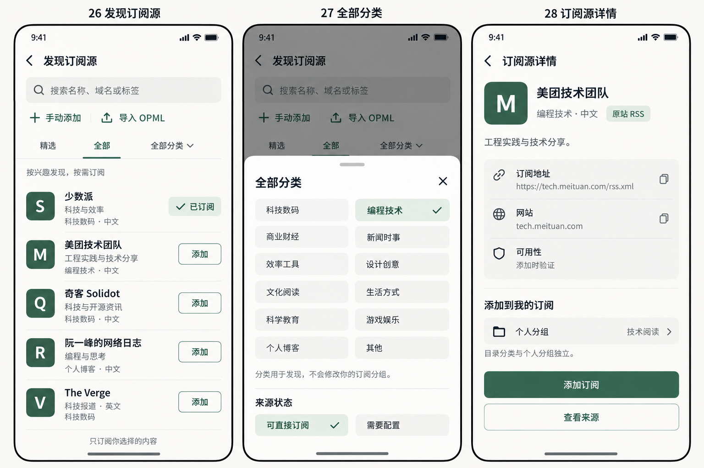
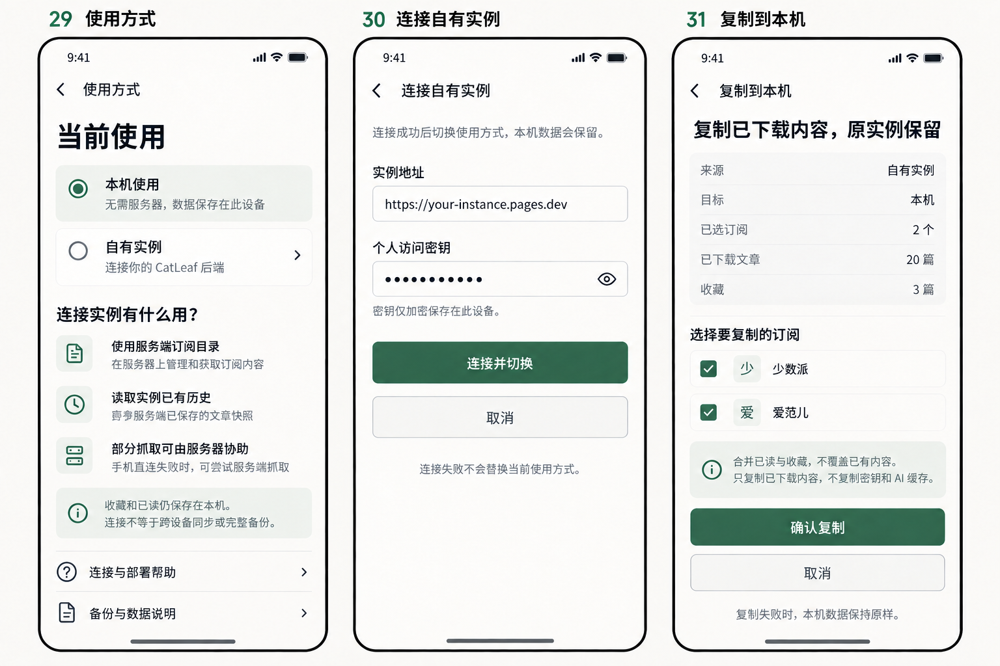
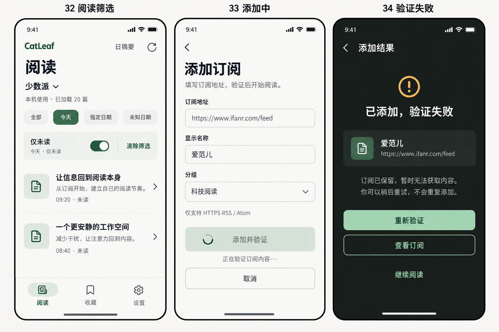

# CatLeaf 本机模式与发现源增量原型

日期：2026-09-25。已确认方向的静态设计交付：**4张评审板，包含23–34共12个页面状态**。保留原22张独立页面图；不是新增12个独立PNG，也不代表App已经实现或通过真机验收。

输入：[PRD v3](../../03-PRD.md)、[页面行为](../../05-页面与状态说明.md)、[设计规范](../../07-设计规范.md)、[数据契约](../../04-架构与接口契约.md)。后续任务：[L01–L09](../../../tasks/本机模式与发现源实施计划.md)。生成过程与修订提示见[prompts](prompts.md)。

## 页面对应

| 编号 | 页面状态 | 任务 / 验收 | 旧页面关系 |
| --- | --- | --- | --- |
| 23 | 欢迎，无需服务器即可开始 | L01/L04；C01 | 替代05的强制首次连接 |
| 24 | 五个推荐源，默认未选，可跳过 | L03/L04；C03/C04 | 新增 |
| 25 | 本机阅读空态，发现/手动/OPML | L02/L04；C01/C02 | 更新20 |
| 26 | 分类发现，搜索与订阅状态 | L03/L04；C03/C04 | 从03、空态及引导进入 |
| 27 | 全部分类面板，12类 | L04；C03/C10 | 新增 |
| 28 | 目录源详情与订阅入口 | L04；C03/C04 | 接现有添加表单 |
| 29 | 使用方式，本机默认、实例可选 | L05；C06/C07 | 更新07/17的入口与说明 |
| 30 | 连接自有实例，成功后切换 | L05；C07 | 05改为设置中的可选流程 |
| 31 | 复制已下载数据到本机的预览 | L05；C08 | 新增，不代替备份恢复 |
| 32 | 日期四项和独立未读开关 | L06；C05 | 更新01筛选区域 |
| 33 | 添加中，文案居中不被转圈挤移 | L02/L06；C05 | 更新09共享提交组件 |
| 34 | 已添加但验证失败，深色示例 | L02/L06；C05/C10 | 新增真实失败结果 |

原02/04/06等未变化的阅读、摘要、收藏布局沿用；10/11 OPML、15/19状态恢复的本机/实例目标与v2兼容行为以页面说明和契约为准，不重复生成整页。图29展示未连接状态；已连接时的origin、切回本机、复制入口，以及图31成功/失败/空态均须按页面说明实现，不能只实现图片展示的单一状态。

## 首次使用：23–25

五源顺序：少数派、爱范儿、IT之家、阮一峰的网络日志、The Verge。默认0项，主按钮禁用；跳过、导入OPML和手动添加始终有去路。已有实例用户升级不重走引导。

## 分类发现：26–28

图26选中“全部”是示例；实际首次进入默认“精选”，固定五源。其他全部合格源归入目录，按分类与搜索组合查看。图中名称、条目和状态仅演示布局，最终可用状态由L03全量核验决定。中性字标不冒充网站官方Logo。

## 使用方式与复制：29–31

实例收益为服务端订阅目录、已保存的文章快照及部分抓取协助；不承诺已读/收藏跨设备同步、自动完整备份或持续归档。图31只复制已下载的所选数据，原实例保留，结果后再主动切换本机。示例数字不是用户手机统计。

## 筛选与提交：32–34

日期顺序固定“全部、今天、指定日期、未知日期”；“仅未读”独立组合，“清除筛选”同时清两维。加载转圈使用独立位置，文案相对整按钮居中。登记成功与RSS验证成功分别反馈，验证失败不重复新增。

## 实施边界

- 图片只定义布局关系。颜色/dp/sp/触控尺寸按设计规范；生成图的渐变、字形误差、手机外框、系统状态栏和示例文本不复制到App。
- 品牌只用正式[猫标SVG](../../assets/brand/catleaf-mark.svg)，操作图标复用[素材索引](../../assets/README.md)；不从PNG切图，不增加网站肖像或未经核验的站标。
- 图30是新输入示意，已保存密钥不得回填/回显。实例能力文案以[帮助](../../14-本机使用与实例帮助.md)为准，生成图微小文字误差不作为实现文本。
- 深色34仅为代表状态，全部新页仍须深浅、360dp、1.3字体、键盘和TalkBack验收。图片不证明这些条件通过。
- 首次引导、联网/离线、部分成功、取消/返回、重进和迁移失败规则见页面说明§10及C01–C10。原G7/G8缺口继续保留。
