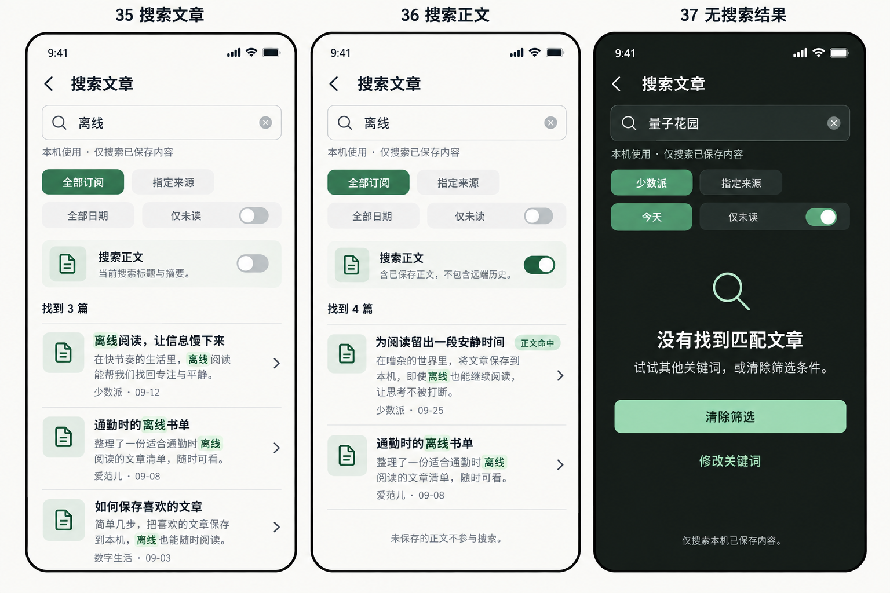
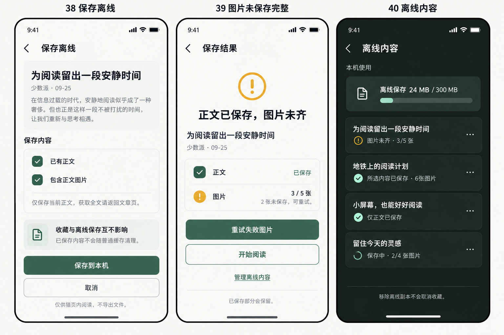

# CatLeaf 搜索与离线增量原型35–40

日期：2026-09-25。2张三屏静态评审板，共6个页面状态；不是6张独立PNG。沿用既有暖白/森林绿、控件和布局，保留原22张图及23–34四组评审板。设计交付完成不等于App实现。

依据：[PRD v3.1 §11](../../03-PRD.md)、[契约§9](../../04-架构与接口契约.md)、[页面§11](../../05-页面与状态说明.md)、[设计规范](../../07-设计规范.md)。开发映射：[Q01–Q04](../../../tasks/本机模式与发现源实施计划.md)。生成提示见[prompts](prompts.md)。

| 页 | 场景 | 任务与验收 |
| --- | --- | --- |
| 35 | 文章标题/摘要搜索，当前范围全库 | Q01，C11 |
| 36 | 含已保存原文的搜索及命中片段 | Q02，C12 |
| 37 | 条件保留的无搜索结果，深色 | Q01/Q02，C11/C12/C15 |
| 38 | 单篇保存确认，正文及可选图片 | Q03，C13 |
| 39 | 正文成功、图片未齐，重试失败项 | Q03，C13/C14 |
| 40 | 设置中的离线内容管理，深色 | Q03/Q04，C14/C15 |

## 搜索35–37

阅读/收藏页顶栏进入，默认沿入口条件；35的“全部订阅”是清除来源后的例子，收藏入口还应显示仅收藏条件。Q01阶段隐藏未实现的正文开关，36在Q02交付。结果数量和文章仅作演示，实际列表可滚动；不能将图36只展示两行误解成结果数错误或硬编码四条。

## 离线38–40

详情更多菜单进入38，状态与更多菜单更新，不扩展底部栏。40从设置→存储进入，不新增根Tab。图38“已有正文”为必需项的状态，不能取消后创建只有图片的包；只有图片选项可切换。

图40占用是示例；实现需明确“全部使用方式24MiB/300MiB、当前本机24MiB”等真实分项，不能把当前范围占用假称总占用。300MiB是初始工程预算，正文/图片的每项限额以PRD为准。生成图中的MB、细微字形、渐变或系统外框不作生产规范。

## 未单独画出的状态与实现边界

复用既有表单、确认和状态模板实现输入空态/查询失败/键盘、保存中与取消、无正文/离线/超限、保存成功/已中断、重新保存/移除确认/无离线内容；全部行为见页面§11和契约§9。34图仍负责加源错误，不能拿39图片未齐替代。

生产控件按dp/sp和已交付SVG实现，不从板图裁切素材。浅深/360dp/1.3字体/读屏须实测。搜索和单篇保存均不调用AI；默认不后台扫源、批量下载或自动续传。两图已视觉检查，尚未运行对应App流程。
